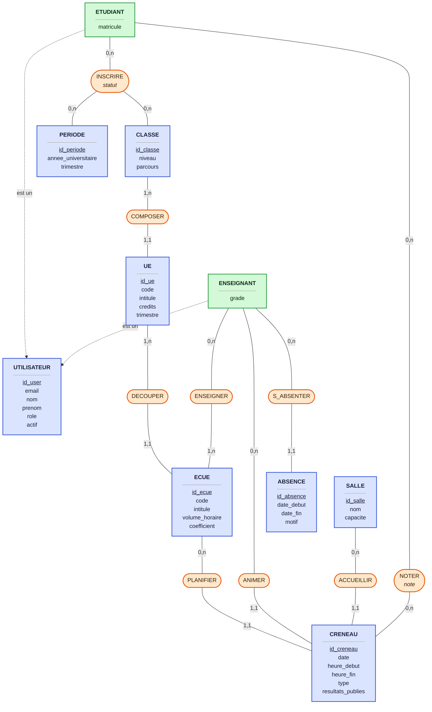
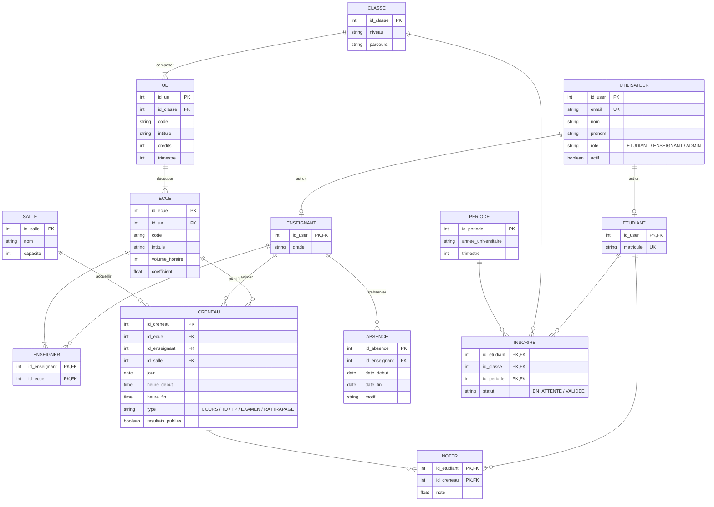
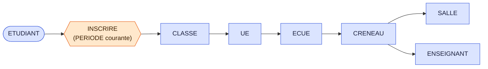

---
tags:
---
---

title: MCD - Gestion des emplois du temps, examens et notes tags:

- projet/jee
- merise
- mcd
- base-de-donnees type: conception statut: brouillon cssclasses:
- wide-page aliases:
- MCD
- Modèle conceptuel de données

---

# MCD — Gestion des emplois du temps, examens et notes

> [!abstract] Résumé Modèle Conceptuel de Données (Merise) pour l'application JEE de gestion de l'école : emplois du temps, examens, notes et inscriptions du trimestre suivant. **Version minimaliste : 10 entités (dont 2 spécialisations), 9 associations.**

> [!info] Légende du schéma
> 
> - 🟦 **Rectangle bleu** = entité
> - 🟧 **Ovale orange** = association (avec ses attributs éventuels)
> - **(min,max)** sur les traits = cardinalités
> - **Trait pointillé** = spécialisation (« est un »)

---

## 1. Schéma MCD (notation Merise)

> [!tip] Astuce Obsidian Le schéma est large : passez la note en **mode lecture** et cliquez sur le diagramme pour le zoomer, ou ajoutez la classe CSS `wide-page` (déjà dans les propriétés) avec un snippet qui élargit la page.

---

## 2. Entités

| Entité           | Attributs                                                                                                   | Remarque                                                                       |
| ---------------- | ----------------------------------------------------------------------------------------------------------- | ------------------------------------------------------------------------------ |
| **UTILISATEUR**  | `id_user`, email, nom, prenom, role (ETUDIANT / ENSEIGNANT / ADMIN), actif                                  | Sur-type. Authentification déléguée à OAuth + 2FA : aucun mot de passe stocké. |
| ↳ **ETUDIANT**   | matricule                                                                                                   | Spécialisation de UTILISATEUR                                                  |
| ↳ **ENSEIGNANT** | grade                                                                                                       | Spécialisation de UTILISATEUR                                                  |
| **CLASSE**       | `id_classe`, niveau, parcours                                                                               | Le nom (« M1-INT ») est dérivé de niveau + parcours, donc non stocké.          |
| **UE**           | `id_ue`, code, intitule, credits, trimestre                                                                 |                                                                                |
| **ECUE**         | `id_ecue`, code, intitule, volume_horaire, coefficient                                                      |                                                                                |
| **SALLE**        | `id_salle`, nom, capacite                                                                                   |                                                                                |
| **CRENEAU**      | `id_creneau`, date, heure_debut, heure_fin, type (COURS / TD / TP / EXAMEN / RATTRAPAGE), resultats_publies | Un créneau planifié, pas une grille de référence.                              |
| **ABSENCE**      | `id_absence`, date_debut, date_fin, motif                                                                   |                                                                                |
| **PERIODE**      | `id_periode`, annee_universitaire, trimestre                                                                |                                                                                |

## 3. Associations (cardinalités min,max)

|Association|Entités liées|Cardinalités|Attributs portés|
|---|---|---|---|
|**COMPOSER**|CLASSE – UE|CLASSE (1,n) · UE (1,1)||
|**DECOUPER**|UE – ECUE|UE (1,n) · ECUE (1,1)||
|**ENSEIGNER**|ENSEIGNANT – ECUE|ENSEIGNANT (0,n) · ECUE (1,n)||
|**PLANIFIER**|ECUE – CRENEAU|ECUE (0,n) · CRENEAU (1,1)||
|**ANIMER**|ENSEIGNANT – CRENEAU|ENSEIGNANT (0,n) · CRENEAU (1,1)||
|**ACCUEILLIR**|SALLE – CRENEAU|SALLE (0,n) · CRENEAU (1,1)||
|**S_ABSENTER**|ENSEIGNANT – ABSENCE|ENSEIGNANT (0,n) · ABSENCE (1,1)||
|**INSCRIRE** (ternaire)|ETUDIANT – CLASSE – PERIODE|chacune (0,n)|`statut` (EN_ATTENTE / VALIDEE)|
|**NOTER**|ETUDIANT – CRENEAU|chacune (0,n)|`note`|

---

## 4. Vue logique (préfiguration du MLD)

> [!note] Pourquoi un second diagramme ? Mermaid n'a pas de notation Merise native. Ce diagramme **entité-relation** montre la même structure sous forme de tables : les associations n-n (ENSEIGNER, INSCRIRE, NOTER) y deviennent des tables de jonction, et la spécialisation devient une relation 1-0..1.

---

## 5. Chemins de navigation (données dérivées)

> [!example] Emploi du temps d'un étudiant Rien n'est stocké : il se calcule en parcourant les associations.

> [!example] Créneaux libres d'un parcours **Créneaux libres** = grille horaire standard (configuration) − CRENEAUX existants de la classe − ABSENCES de l'enseignant.

---

## 6. Choix de conception

> [!success] Ce qui rend le modèle minimaliste
> 
> - **Une seule entité, CRENEAU, couvre les cours, examens et rattrapages.** Un examen est un CRENEAU avec `type = EXAMEN`, un rattrapage un autre CRENEAU avec `type = RATTRAPAGE` pour le même ECUE. Pas d'entités EXAMEN ni RATTRAPAGE, et les notes d'examen et de rattrapage sont conservées naturellement.
> - **Pas de lien CLASSE–CRENEAU.** La classe est déjà atteignable via CRENEAU → ECUE → UE → CLASSE.
> - **Créneaux libres et emploi du temps étudiant dérivés** (voir section 5).
> - **PERIODE conserve l'historique des inscriptions.** Sans elle, un étudiant ne pourrait être lié qu'une fois à une classe. C'est aussi ce qui permet « inscription du trimestre suivant selon les notes ».
> - **Rien n'est persisté pour les notifications, alertes et le dashboard.** Mails de changement, alerte « examen à moins de 2 semaines » et dashboard admin sont déclenchés par des événements applicatifs ou calculés par requêtes. Moyennes et décision validé/ajourné sont calculées depuis NOTER et les coefficients, puis stockées uniquement dans `INSCRIRE.statut`.
> - **`resultats_publies` sur CRENEAU** déclenche la notification « résultats disponibles ». La confidentialité (« seul moi vois mes résultats ») relève du contrôle d'accès : un étudiant ne voit que les lignes NOTER où `ETUDIANT = moi`.

## 7. Règles de gestion

> [!warning] Non exprimables dans le MCD : à implémenter en code ou en contraintes SQL
> 
> 1. NOTER n'est autorisé que si `CRENEAU.type` vaut EXAMEN ou RATTRAPAGE, et si l'étudiant est inscrit dans la classe de cet ECUE.
> 2. Deux CRENEAUX ne peuvent pas se chevaucher pour la même salle, le même enseignant, ni la même classe (vérifié via ECUE → UE).
> 3. Un CRENEAU ne peut pas être réservé si son enseignant a une ABSENCE couvrant cette date.
> 4. L'enseignant d'un CRENEAU doit être lié à son ECUE via ENSEIGNER.

## 8. Hypothèses à valider

> [!question]- Cliquez pour déplier les hypothèses modifiables
> 
> - Une UE appartient à une seule classe (UE par parcours dans vos données existantes). En cas de tronc commun, COMPOSER devient (n,n).
> - Un CRENEAU a une seule salle. Pour un grand examen sur plusieurs salles, créer un CRENEAU par salle.
> - ENSEIGNER peut devenir un lien « responsable » 1,1 sur ECUE si c'est trop lourd. Gardé en n,n car CM et TD sont souvent assurés par des personnes différentes.
> - Version encore plus légère : supprimer les spécialisations ETUDIANT/ENSEIGNANT et ne garder que UTILISATEUR avec `role`.

---

## 9. Suite du projet

- [ ] MCD
- [ ] MLD (tables PostgreSQL) → [[MLD - Emplois du temps]]
- [ ] Diagramme de classes JPA → [[Diagramme de classes JPA]]
- [ ] Diagramme de cas d'utilisation
- [ ] Diagrammes de séquence et d'activité